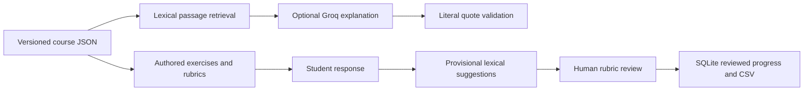

# TutorTrace

A personal evidence-first learning workflow: retrieve passages, optionally request an AI explanation, practice authored exercises, review provisional rubric suggestions, and export reviewed progress.

## Run

Python 3.11+ and Windows PowerShell:

```powershell
python -m venv .venv
.\.venv\Scripts\python.exe -m pip install -r requirements.txt
.\.venv\Scripts\python.exe -X utf8 -m unittest discover -s tests -v
.\.venv\Scripts\python.exe -X utf8 evaluate.py --output reports/my-evaluation-v1.json
.\.venv\Scripts\python.exe -m streamlit run app.py --server.address 127.0.0.1 --server.port 8512
```

Open http://127.0.0.1:8512. See [Vietnamese walkthrough](HUONG_DAN.md), [validation scope](VALIDATION.md), and [case study](CASE_STUDY.md).

## Workflow and architecture



- `core.py`: Unicode normalization, lexical retrieval, source quote checks, course fingerprints, concept-based score suggestions.
- `provider.py`: optional Groq JSON response, ID and verbatim quote validation, redacted errors, no retries.
- `store.py`: answer and rubric snapshots, revision checks, atomic edits/reviews, review invalidation and event history.
- `app.py`: four-tab local workflow. Course and answer changes do not silently reuse old approvals.
- `evaluate.py`: separate retrieval and lexical grading fixture reports.

Exercises are authored, not generated by an LLM. Grades require explicit review and start from zero in the review form. The latest attempt per exercise/course fingerprint determines progress; an unreviewed resubmission hides the old grade. Versions are kept separate, with no aggregate mastery or learning-gain claim.

## Optional AI and privacy

No key is needed for the core workflow. To request an explanation, enter a Groq key in the password field, consent to sending the current question and retrieved passages, then press the AI button. Responses and keys are not saved to the database. The key remains in the local Streamlit session while entered. Learner answers are not sent to Groq by this feature.

The default editable model is `openai/gpt-oss-120b`, listed in [Groq model documentation](https://console.groq.com/docs/models) when checked on 2026-11-14. The integration uses the [Groq OpenAI-compatible endpoint](https://console.groq.com/docs/openai). Availability and account permissions can change. Live provider output was not benchmarked.

Only use demo data. Answers, rubric snapshots, reviews and events are stored unencrypted in `private/tutor.sqlite3`. Learner/reviewer aliases are labels, not authentication or authorization. This is a local single-user prototype, not a school deployment or a tamper-proof audit service.

## Important limits

Retrieval uses word overlap, not semantic embeddings. Source matches do not prove answerability. The optional AI validator confirms quote provenance only, not whether a quote supports a claim. A fluent false explanation can still pass it. Human verification remains necessary.

Lexical rubric suggestions can reward a wrong, negated or keyword-stuffed answer and penalize a correct paraphrase. A test deliberately demonstrates this failure. These are review aids, not trustworthy automatic grades. The small self-authored course is not a general educational evaluation dataset.

`private/`, reports, environment files and virtual environments are ignored by Git. Publication instructions are kept outside this repository.
